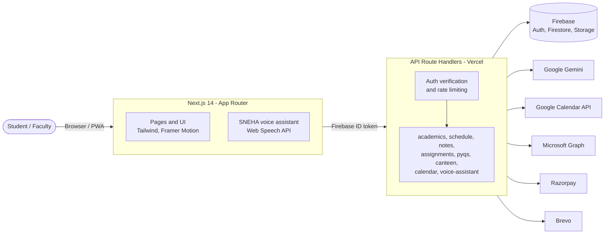
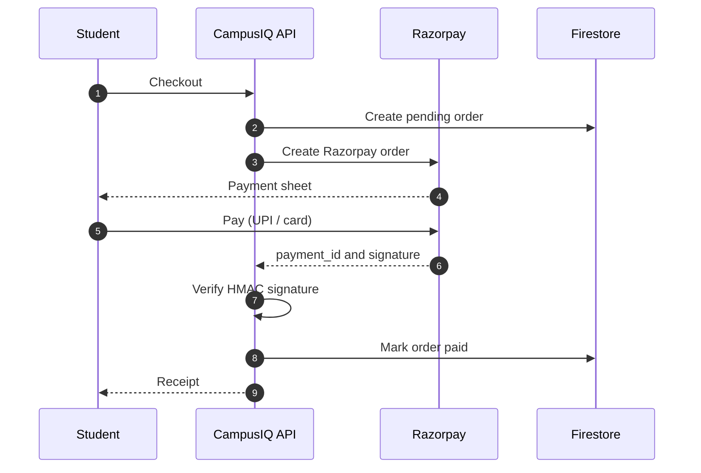
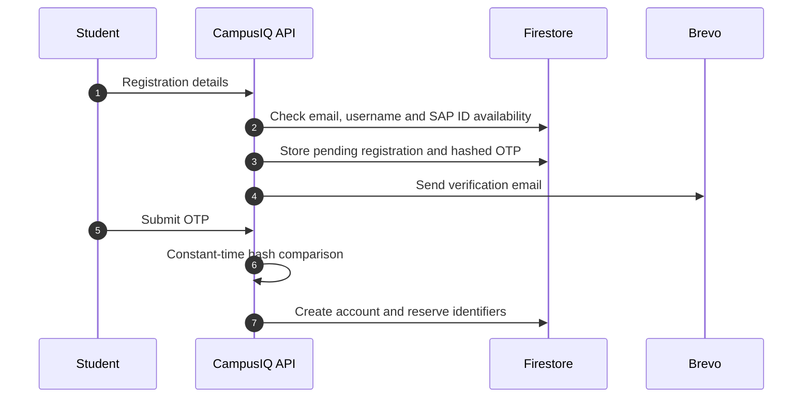

<div align="center">


# CampusIQ

**An AI-powered campus platform for students of NMIMS MPSTME, Mumbai.**

Academics, scheduling, coursework, campus services and community, in one place.

[**Live Site**](https://www.campusiqmpstme.space/) &nbsp;·&nbsp;
[Features](#features) &nbsp;·&nbsp;
[Architecture](#architecture) &nbsp;·&nbsp;
[Getting Started](#getting-started) &nbsp;·&nbsp;
[Roadmap](#roadmap)

<br/>

[](https://www.campusiqmpstme.space/)


</div>

---

## Overview

Student life at MPSTME is spread across many disconnected places. The timetable is a PDF, assignments live in Microsoft Teams, results arrive as scanned marksheets, exam rules sit in a long policy document, and the canteen means a queue during a short break.

CampusIQ brings these together in a single web app and adds an AI layer on top:

- **One timetable upload** becomes a daily schedule that you can query in plain language and sync to Google Calendar.
- **Attendance** is tracked per subject, with a calculator for the 75% requirement.
- **Teams assignments** are synced, prioritized and scored for workload.
- **Policy documents** can be asked questions directly, with answers grounded in the source text.
- **Canteen orders** are placed and paid for ahead of time, with a digital receipt.

## Features

| Module | Capabilities |
|:--|:--|
| **Academics** | Attendance tracker and bunk calculator · Result analyzer (OCR + Gemini) · Examination-policy Q&A · Student Resource Book Q&A |
| **Schedule** | Timetable upload and AI extraction · Batch-aware day and week views · Natural-language schedule queries · Google Calendar sync |
| **Resources** | Notes with AI summaries and Q&A · Assignment hub with Microsoft Teams sync, priorities, health score and reminders · Previous-year question papers · Exam survival kits |
| **Campus** | Canteen menu, cart and checkout · Razorpay payments with server-side verification · Order history and PDF receipts · Library discussion-room booking |
| **Community** | Campus events · Campus Voices, a moderated anonymous student feed |
| **Services** | Quick access to railway concession, library OPAC, student portal and other administrative services |
| **SNEHA** | Voice assistant for hands-free navigation and questions, using on-device command matching with Gemini as a fallback |
| **Proactive alerts** | Reminders for upcoming classes, low attendance and approaching deadlines |

<details>
<summary><b>Feature details</b></summary>

<br/>

**Academics**
- Per-subject attendance with a calculator that shows how many lectures can be missed while staying above 75%.
- Marksheets uploaded as images or PDFs are read with Tesseract.js / pdf.js and analyzed by Gemini for weak subjects and SGPA trends.
- Question answering over the examination policy and the Student Resource Book.

**Schedule**
- Timetables are extracted from an image or PDF, then filtered to the student's batch.
- Entries can be edited, deleted and annotated with comments.
- A chat interface answers questions such as "When is my next free slot?".
- Two-way Google Calendar sync over OAuth 2.0.

**Resources**
- PDF and DOCX notes are parsed with `pdf-parse` and `mammoth`, then summarized or queried.
- Assignments come from Microsoft Teams through the Graph API, or are added by hand. Includes workload overview, priority suggestions, an on-time health score and configurable reminders.
- PYQ library with downloads. Admins can bulk-upload papers with a script.

**Campus**
- Order flow: cart, checkout, then Razorpay (UPI or card). The order is marked paid only after the HMAC signature is verified on the server.
- Order history and printable receipts generated with `jsPDF`.

**Platform**
- OTP-verified signup through Brevo. The account is created only after the code is confirmed.
- Unique username and SAP ID reservation, plus role-based dashboards for students and faculty.
- Installable as a Progressive Web App.

</details>

## Architecture



<details>
<summary><b>Payment flow</b></summary>



</details>

<details>
<summary><b>Signup flow</b></summary>



</details>

## Tech Stack

| Layer | Technologies |
|:--|:--|
| Frontend | Next.js 14 (App Router), React 18, TypeScript, Tailwind CSS, Framer Motion |
| Forms and validation | React Hook Form, Zod |
| Backend | Next.js Route Handlers on Vercel, Firebase Admin SDK |
| Data | Cloud Firestore, Firebase Storage, Firebase Authentication |
| AI | Google Gemini (Flash and Pro models) with per-user rate limiting |
| Document processing | Tesseract.js, pdf.js, pdf-parse, Mammoth, jsPDF |
| Integrations | Google Calendar API, Microsoft Graph, Razorpay, Brevo |
| Voice | Web Speech API |

## Getting Started

### Prerequisites

- Node.js 18 or later
- A Firebase project with Authentication, Firestore and Storage enabled, plus a service account
- A Gemini API key from [Google AI Studio](https://aistudio.google.com/)
- Optional: Google OAuth, Microsoft Entra, Razorpay and Brevo credentials for the corresponding integrations

### Installation

```bash
git clone https://github.com/srjcybersec/CampusIQ-MPSTME.git
cd CampusIQ-MPSTME
npm install
cp .env.example .env.local   # then fill in the values
```

Deploy the security rules and indexes:

```bash
firebase deploy --only firestore:rules,firestore:indexes,storage
```

Start the development server:

```bash
npm run dev
```

The app runs at `http://localhost:3000`. Every environment variable is documented in [`.env.example`](.env.example).

### Scripts

| Command | Description |
|:--|:--|
| `npm run dev` | Start the development server |
| `npm run build` | Create a production build |
| `npm run start` | Serve the production build |
| `npm run lint` | Run ESLint |
| `npm run upload-pyqs` | Bulk-upload question papers from a local `PYQs/` folder to Firebase |

## Project Structure

```text
app/
  academics/  schedule/  resources/  campus/  community/  services/  extras/
  auth/                  Login, OTP signup, email verification
  api/                   Route handlers (about 50)
components/              UI components grouped by feature
lib/
  firebase/              Client and Admin SDK, data access
  ai/  gemini/           Gemini client and rate limiting
  google-calendar/       Calendar OAuth client
  microsoft-graph/       Teams / Graph client
  auth/                  OTP, registration, identifier reservation
  schedule/              Timetable extraction and parsing
  voice-assistant/       Command matching for SNEHA
scripts/                 Bulk upload and maintenance scripts
firestore.rules          Firestore security rules
storage.rules            Storage security rules
```

## Security

- No credentials in the repository. All secrets are supplied through environment variables.
- Protected API routes verify a Firebase ID token on the server.
- Firestore and Storage rules limit each user to their own data.
- Payments are confirmed only after server-side HMAC signature verification.
- OTPs are stored hashed and compared in constant time. CampusIQ never stores passwords.
- AI endpoints are rate-limited per user.

## Roadmap

- [x] Academics suite: attendance, results, policy Q&A
- [x] Timetable extraction and Google Calendar sync
- [x] Microsoft Teams assignment sync
- [x] Canteen ordering with Razorpay
- [x] SNEHA voice assistant
- [x] OTP-verified signup
- [x] Campus Voices community feed
- [ ] Empty-classroom finder
- [ ] In-app library room booking with live availability
- [ ] Push notifications for proactive alerts
- [ ] Faculty analytics dashboard

## Contributing

Issues and pull requests are welcome. For larger changes, please open an issue first to discuss the proposal.

1. Fork the repository and create a branch (`git checkout -b feature/your-feature`).
2. Commit your changes using [Conventional Commits](https://www.conventionalcommits.org/).
3. Open a pull request.

## Author

**Shivansh Jindal** · [GitHub](https://github.com/srjcybersec)

Built for the students of NMIMS MPSTME, Mumbai.
